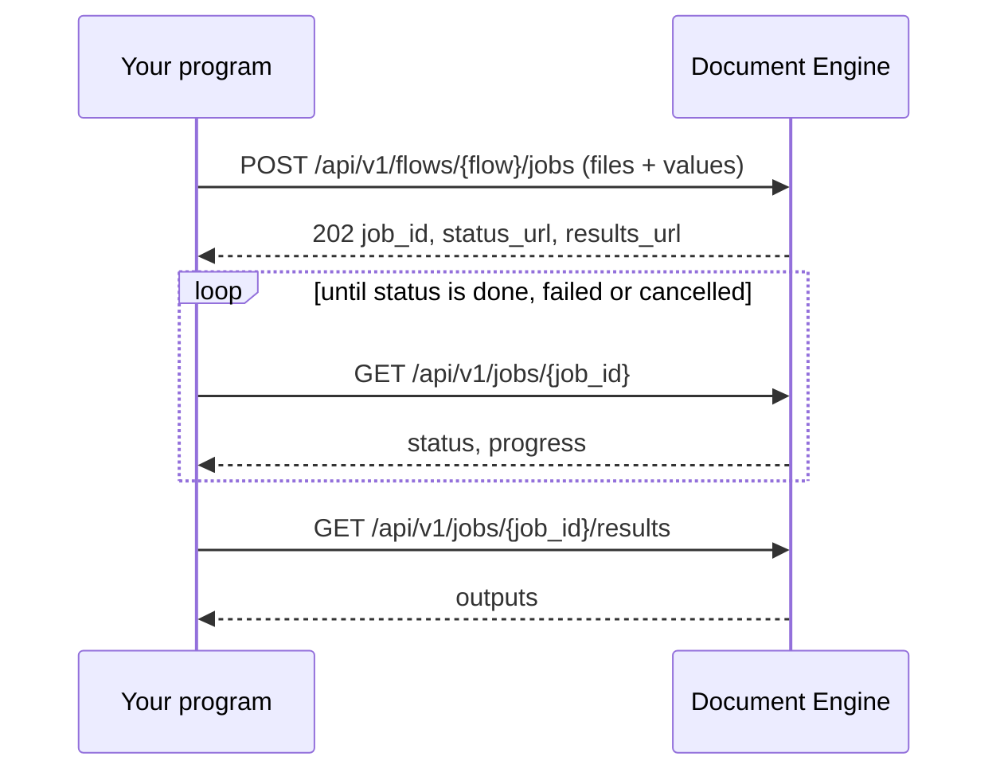

[Documentation](../README.md) › API

# Running a flow from code

A flow that has been published in the builder can be run by any program that can make HTTP requests. The
program sends the flow's name, the files and any values the flow asks for, receives a job id, and polls until
the job is done. This page is the starting point for developers: it explains the model and walks through one
complete run.

**On this page**

- [How it fits together](#how-it-fits-together)
- [Before you start](#before-you-start)
- [A complete run in three requests](#a-complete-run-in-three-requests)
- [Finding out what a flow needs](#finding-out-what-a-flow-needs)
- [Sending a file that is already stored](#sending-a-file-that-is-already-stored)
- [Rules worth knowing](#rules-worth-knowing)

## How it fits together



There are no callbacks. The engine never calls your program; your program asks.

| Address | What it does |
|---|---|
| `GET /api/v1/flows` | Lists the published flows and what each one needs |
| `GET /api/v1/flows/{flow}` | Describes one flow: its files, values and outputs |
| `POST /api/v1/flows/{flow}/jobs` | Starts a job |
| `GET /api/v1/jobs/{job_id}` | Reports the job's status and progress |
| `GET /api/v1/jobs/{job_id}/results` | Returns the outputs of a finished job |
| `POST /api/v1/jobs/{job_id}/cancel` | Stops a job |
| `POST /api/v1/files` | Stores a file for reuse and returns its id |

The [reference](reference.md) describes every field of every request and reply.

## Before you start

1. **The flow must be published.** Open it in the builder and choose **Publish**. See
   [Publishing a flow](../guide/publishing.md). A flow that exists but is not published answers `404` with the
   code `flow_not_published`.
2. **Know the address of the application.** The examples use `http://localhost:8000`, the address of a
   [local setup](../operations/local-setup.md). Replace it with your own.
3. **Open the API panel.** In the builder, the **API** button shows the exact commands for the flow on the
   canvas, with its own file and value names filled in. Copying from there is the quickest way to begin.

> **Not yet confirmed:** the application has no sign-in of its own. On Databricks Apps the platform sits in
> front of the application and decides who can reach it; how callers authenticate there will be confirmed in
> the first deployment. See [Limits](../operations/limits.md).

## A complete run in three requests

The sample flow **Check an invoice against its order** takes three files (`Purchase order`, `Delivery note`,
`Invoice`) and two optional values.

### 1. Start the job

Each file goes in a form field named after the flow's file input. Values go in one field named `values`, as
JSON.

```bash
curl -X POST 'http://localhost:8000/api/v1/flows/check-an-invoice-against-its-order/jobs' \
  -F 'Purchase order=@purchase-order.pdf' \
  -F 'Delivery note=@delivery-note.png' \
  -F 'Invoice=@invoice.pdf' \
  -F 'values={"Price tolerance": 10, "Accept delivery charges": true}'
```

The reply arrives at once, with status `202 Accepted`:

```json
{
  "job_id": "job_b0bec21258",
  "status": "queued",
  "flow": "Check an invoice against its order",
  "flow_version": 2,
  "status_url": "http://localhost:8000/api/v1/jobs/job_b0bec21258",
  "results_url": "http://localhost:8000/api/v1/jobs/job_b0bec21258/results"
}
```

Keep the `job_id`. Nothing else identifies the job.

### 2. Poll the status

```bash
curl 'http://localhost:8000/api/v1/jobs/job_b0bec21258'
```

```json
{
  "job_id": "job_b0bec21258",
  "status": "running",
  "progress": { "calls_done": 2, "calls_planned": 6 },
  "error": null
}
```

(Shortened. The [reference](reference.md#get-apiv1jobsjob_id) lists every field.)

`status` moves from `queued` to `running` and ends at `done`, `failed` or `cancelled`. Poll every few
seconds; a job on a long file can take minutes, and longer when many jobs are waiting. See
[How the queue decides what goes first](../how-it-works/queue-and-priority.md).

### 3. Fetch the results

```bash
curl 'http://localhost:8000/api/v1/jobs/job_b0bec21258/results'
```

```json
{
  "job_id": "job_b0bec21258",
  "status": "done",
  "outputs": [
    {
      "name": "Invoice verdict",
      "format": "text",
      "text": "The invoice does not agree with the order on one line ... [Invoice p. 2]",
      "items": [ { "pages": [1, 2, 3], "input": "Invoice", "text": "...", "data": null, "truncated": false } ]
    }
  ]
}
```

A flow has one entry in `outputs` for each Output block. Text outputs carry `text`. Outputs fed by a step with
a schema also carry a `table` with `columns` and `rows`.

Asking for results before the job has finished answers `409` with the code `job_not_finished`.

## Finding out what a flow needs

A program does not have to be told in advance what a flow takes. It can ask:

```bash
curl 'http://localhost:8000/api/v1/flows/check-an-invoice-against-its-order'
```

```json
{
  "name": "Check an invoice against its order",
  "flow_id": "flow_sample_three_way",
  "version": 2,
  "files": [ { "name": "Purchase order" }, { "name": "Delivery note" }, { "name": "Invoice" } ],
  "values": [
    { "name": "Price tolerance", "type": "number", "required": false, "default": 0.5,
      "description": "Largest unit price difference that still counts as agreeing with the order" },
    { "name": "Accept delivery charges", "type": "yesno", "required": false, "default": false,
      "description": "Let a delivery charge pass when the order did not list one" }
  ],
  "outputs": [ { "name": "Invoice verdict", "format": "text" } ],
  "submit_url": "http://localhost:8000/api/v1/flows/flow_sample_three_way/jobs"
}
```

- `files` are the flow's sources. Every one needs a file on every run.
- `values` are the flow's [value inputs](../guide/value-inputs.md). One with `"required": true` has no default
  and must be sent; the others may be left out.

## Sending a file that is already stored

Sending the file with the job is the normal way. When the same file is used for many jobs, store it once and
send its id instead:

```bash
curl -X POST 'http://localhost:8000/api/v1/files?name=price-list.pdf' \
  -H 'Content-Type: application/pdf' --data-binary @price-list.pdf
```

```json
{ "file_id": "doc_c406131a29", "name": "price-list.pdf", "kind": "pdf", "pages": 3 }
```

Then start jobs with a JSON body, or mix ids and uploads in a form:

```bash
curl -X POST 'http://localhost:8000/api/v1/flows/check-an-invoice-against-its-order/jobs' \
  -H 'Content-Type: application/json' \
  -d '{"files": {"Purchase order": "doc_c406131a29", "Delivery note": "doc_6d1bb50555", "Invoice": "doc_04decf63b9"}}'
```

The status of every job lists the `file_id` of each file it ran on, so an id can also be taken from an earlier
job.

## Rules worth knowing

- **The published version is what runs.** Edits in the builder change nothing for callers until the flow is
  published again. Each job records the `flow_version` it ran.
- **A flow is addressed by its name.** Case, spacing and punctuation do not matter:
  `Check an invoice against its order`, `check-an-invoice-against-its-order` and
  `check_an_invoice_against_its_order` are the same flow. Letters and digits of every script count, so
  names in non-Latin scripts work and accented letters matter: `cafe` and `café` are different names. The
  name is the one the flow had when it was
  published: renaming it in the builder takes effect for callers at the next publish. The flow id
  (`flow_sample_three_way`) also works and never changes.
- **A refused request leaves nothing behind.** Everything is checked before a job exists. If a value is
  wrong or a file cannot be read, no job is created and the files that request brought are not kept.
- **A file's name is a label.** Two files may share a name. Only the `file_id` identifies a file.
- **One request, one job.** To run a flow on many files, send one request per file. Each gets its own job id.
- **Jobs share one queue with everyone else.** A job is `interactive` unless the request says
  `priority=bulk`. Interactive jobs go ahead of bulk jobs. Use `bulk` for large background work.
- **File types:** PDF, image or text. See [File types](../guide/file-types.md).
- **Sizes.** A file may be at most 200 MB, and a JSON body on the job-start address at most 2 MB. A form
  upload must carry a `Content-Length` header; without one the reply is `411` with the code
  `length_required`. A request that is too large answers `413`. See the
  [reference](reference.md#errors).

## See also

- [API reference](reference.md): every request, reply and error code
- [Examples](examples.md): a complete client in Python and in shell
- [Publishing a flow](../guide/publishing.md): making a flow callable, and taking it back
- [Value inputs](../guide/value-inputs.md): declaring the values a flow accepts
- [Limits](../operations/limits.md): sizes, what is not built, and what is not yet confirmed
