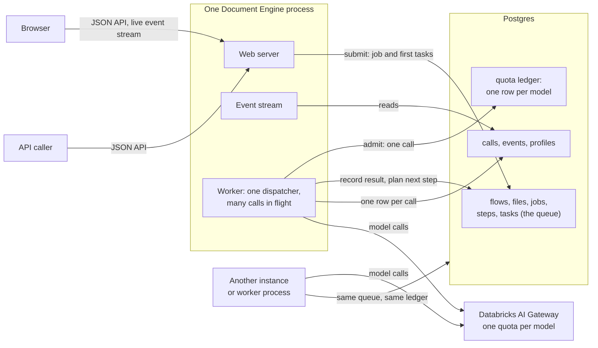

[Documentation](../README.md) › How it works

# How it works

This section explains how Document Engine copes with a heavy workload: how model calls are queued, how the engine decides which call goes next, and how it keeps running when many jobs are waiting and each makes many calls. It is for engineers and technical managers. This page gives the architecture in one page; the other pages each take one part of it.

**On this page**

- [The idea in four sentences](#the-idea-in-four-sentences)
- [The parts](#the-parts)
- [One process](#one-process)
- [Postgres holds all state](#postgres-holds-all-state)
- [The gateway client](#the-gateway-client)
- [Several instances share one quota](#several-instances-share-one-quota)
- [What has been measured and what has not](#what-has-been-measured-and-what-has-not)
- [Reading order](#reading-order)

## The idea in four sentences

Every model call a [job](../glossary.md#job) needs is a [task](../glossary.md#task) in a queue, one queue per model. A ledger in the database keeps a running estimate of how much of each model's output quota is in use. A task is sent only when the ledger says it fits, so the gateway has no reason to reject it. When the quota is busy, tasks of interactive jobs go before tasks of bulk jobs.

The result is that the ceiling on throughput is the model quota, not the application, and that a person who starts one job while a large batch is running does not wait behind the batch.

## The parts

| Part | What it does |
|---|---|
| Web server | Serves the screens and the JSON API. Submitting a job writes the job and its first tasks to Postgres. |
| Worker | Asks the ledger for the next task, makes the model call, records the result, and plans the next step of the job. |
| Event stream | Reads new rows of the `events` table and sends them to the browsers that are watching. |
| Postgres | Holds everything: flows, files, jobs, tasks, the queue, the quota ledger and the events. |
| Gateway client | Makes the model calls and classifies each reply as a success, a rejection, or one of the failures. |

## One process

`python -m doc_engine serve` starts one process that contains the web server, a worker and the event stream together.

- **The worker** has one dispatcher loop and up to `worker.concurrency` model calls in flight (the configured default is 128). The dispatcher is the only thing in the process that asks for admission, so a blocked queue is checked by one waiter, not by every idle slot. [The queue and priority](queue-and-priority.md#how-workers-wait) explains how it waits.
- **The event stream** checks the `events` table four times a second, and only while at least one browser is connected. Once a second it also sends a snapshot of the quota for every model. A browser that connects for one job first receives that job's earlier events from the table, so a page opened late, or reopened after a lost connection, shows the same history.
- **The worker can be switched off** in the web process with `worker.enabled: false`. Then `python -m doc_engine worker` runs workers as separate processes. The same command adds extra worker processes beside an app that already runs one.

All settings are described in [Settings](../operations/settings.md).

## Postgres holds all state

Nothing the engine needs is held only in process memory. A process can stop at any moment and another can continue the work, because the work is rows in tables.

| Table | What it holds |
|---|---|
| `flows`, `flow_versions` | Each flow's working draft and its saved versions |
| `documents` | Every [file](../glossary.md#file), including its content. Instances share no disk, so files live in the database. |
| `jobs` | One row per job, with the job's own copy of the flow |
| `job_steps` | One row per source, step and output of a job: its state and progress |
| `tasks` | One row per model call to make. The rows in state `ready` are the queue. |
| `quota` | One row per model: its limits and the ledger's current level. This row is the single authority on what may be sent. |
| `reservations` | One row per admitted call: what the ledger counts for it while it is in flight |
| `quota_minutes` | Calls admitted per model and minute, which the queries-per-hour check adds up |
| `profiles` | What the calls of each step really produced: learned output, input and duration |
| `calls` | One row per model call made, successful or not |
| `events` | One row per state change. The live screens and the replay of a finished run read this table. |
| `cache_warm` | Which static prompts have a warm cache entry, so jobs can share a warm-up |
| `workers` | The worker processes that are alive, with their last heartbeat |

Two database functions do the scheduling. `de_admit` picks the next task and admits it if it fits; `de_release` records a completed call in the ledger. A third, `de_reap`, returns the calls of a lost worker to the queue, and sets aside a call that has been returned too often. Because the decision is made inside the database, with the model's quota row locked, it does not matter which process asks.

## The gateway client

Model calls go to the Databricks AI Gateway through one client per process.

- The client never retries by itself. Every rejection and every error comes back to the engine, which decides what to do. See [Failures and recovery](failures-and-recovery.md).
- The access token is read again for every request, so short-lived tokens keep working.
- A call may run for up to `gateway.request_timeout_s` (configured default 600 seconds).
- The client keeps at most `gateway.max_connections` connections (configured default 512). The engine refuses to start if this does not exceed `worker.concurrency`.
- Each reply is classified as one of: success, rejection (HTTP 429), transient error, permanent error, refusal, or empty reply.

## Several instances share one quota

Several app instances, or an app and extra worker processes, can run at once against the same Postgres database. They share the queue and the ledger:

- Admission locks the model's row in `quota`, so two processes cannot both admit a call into the same free space.
- Each process copies the model limits from its configuration into `quota` when it starts. The ledger's level is kept.
- A completed call in one process wakes the dispatchers of the others through a Postgres notification. If notifications are not available, dispatchers fall back to timed checks.
- The live screens read the `events` table, so they show the same thing on every instance.

More processes add calls that can be in flight and survive the loss of one process. They do not add throughput beyond the model quota. [Under heavy load](heavy-load.md#several-worker-processes-or-app-instances) goes into this.

> **Not yet confirmed:** several worker processes and the recovery of a killed worker pass on the fake gateway only. They have not run on the real gateway, on Lakebase, or on Databricks Apps. Whether Postgres notifications are available on Lakebase is reported by the preflight check and is to be confirmed in the first deployment.

## What has been measured and what has not

The scheduler design was measured on the real Databricks AI Gateway in an earlier proof of concept, on Sonnet 5.5 only, at limits of 1,000,000 input tokens per minute and 100,000 output tokens per minute. This codebase has so far run only against the [fake gateway](../operations/fake-gateway.md).

In this section, a fact about the real gateway carries the words "measured in the proof of concept on Sonnet 5.5". Everything else describes what the code does. Numbers that come from configuration are called configured defaults. Where a behaviour has not been run on the real gateway, a **Not yet confirmed** note says so.

## Reading order

1. [Jobs and tasks](jobs-and-tasks.md): what happens from submission to results.
2. [The queue and priority](queue-and-priority.md): which task goes next, and what interactive and bulk mean.
3. [The quota ledger](quota-ledger.md): how the engine decides that a call fits. This is the heart of the design.
4. [Under heavy load](heavy-load.md): ten large jobs at once, step by step, and where the ceiling is.
5. [Prompt caching](prompt-caching.md): the warm-up call and what it saves.
6. [Failures and recovery](failures-and-recovery.md): every failure path, what the engine does and what the user sees.
7. [Estimates](estimates.md): how the builder predicts calls, tokens and cost.

## See also

- [Concepts](../start/concepts.md): flows, steps, instructions and jobs, before the mechanics.
- [Settings](../operations/settings.md): every setting named in this section.
- [Monitoring](../operations/monitoring.md): what to watch while the engine runs.
- [Limits](../operations/limits.md): the hard limits in one place.
- [Glossary](../glossary.md): the terms used throughout.
