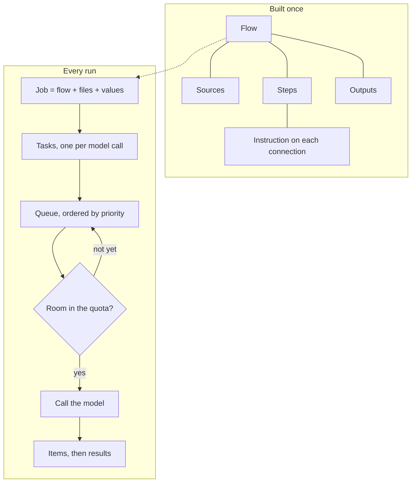

[Documentation](../README.md) › Start here › Concepts

# Concepts

The words this documentation uses, each explained in a few sentences and in the order that makes them easiest
to learn. Read it once from top to bottom; afterwards the [glossary](../glossary.md) is quicker for looking a
word up.

**On this page**

- [Files and pages](#files-and-pages)
- [Flow](#flow)
- [Source](#source)
- [Step](#step)
- [Items](#items)
- [Instruction](#instruction)
- [Reference](#reference)
- [Value input](#value-input)
- [Output](#output)
- [Versions and publishing](#versions-and-publishing)
- [Job, task and call](#job-task-and-call)
- [Priority](#priority)
- [Quota](#quota)
- [How the words fit together](#how-the-words-fit-together)

## Files and pages

A **file** is anything you upload: a PDF, an image or a text file. Every file is made of **pages**. A PDF has
the pages it has. An image is one page. A text file is cut into pages when it is uploaded. "Page" means the
same thing for all three: it is what a step reads and what a page reference points at.
More: [File types](../guide/file-types.md).

## Flow

A **flow** is the whole recipe, drawn on a canvas: where files come in, which steps read them, how the steps
feed one another, and what comes out. A flow is built once and run many times, on different files.
More: [Flow builder](../guide/builder.md).

## Source

A **source** is a block where a file enters the flow. A flow can have one source or several, and each has a
name, such as *Invoice* or *Purchase order*. Each source takes exactly one file per run.
More: [Several files in one flow](../guide/several-files.md).

## Step

A **step** is a block that calls a model. It has a prompt that says what to do, a choice of model, and a
description of what the answer should look like: free text, or named fields that the engine checks.
More: [Steps](../guide/steps.md).

## Items

What moves along a connection is a list of **items**. Out of a source, each page is one item. Out of a step,
each answer the step produced is one item. Every item remembers which pages it covers, which is how a finding
at the end of a flow can still say *page 12*.

## Instruction

The connection into a step carries an **instruction**, which says how the step is applied to the items
arriving on it.

| Instruction | What it does | Calls |
|---|---|---|
| **Map** | Runs the step on one small group of consecutive items at a time. The group is a **window**; its size and overlap are set on the connection. | One per window |
| **Reduce** | Runs the step once, on all the items together | One |
| **Filter** | Keeps only the items whose earlier answer matches a rule, such as *page type equals lab report*, then runs the step on each kept item | One per kept item |

More: [Instructions](../guide/instructions.md).

## Reference

A step works through one input. Anything else connected to it is a **reference**: material the step is given
whole, on every call, to consult. A reference can be the finished answer of another step, or an entire file.
A step that checks each invoice page against the purchase order has the invoice as its input and the order as
a reference.
More: [Several files in one flow](../guide/several-files.md).

## Value input

A **value input** is a small value that a run supplies alongside its files: a number, a choice, a yes or no, a
short text. The flow's author declares it and writes `{{Name}}` in a prompt where the value should appear. A
tolerance, a language or a report date are typical.
More: [Value inputs](../guide/value-inputs.md).

## Output

An **output** is a block that collects the answers of one step as a result of the flow, as text or as a table.
A flow can have several.
More: [Results screen](../guide/results-screen.md).

## Versions and publishing

The canvas is a draft. **Save version** keeps a numbered copy. **Publish** keeps a numbered copy and also makes
it the one that outside programs run. Later edits stay private until the flow is published again.
More: [Publishing a flow](../guide/publishing.md).

## Job, task and call

A **job** is one run of a flow on a particular set of files and values. The engine breaks a job into
**tasks**, one for each model **call** the job needs. A job on a long file can be several hundred tasks. A job
is `queued`, then `running`, and ends `done`, `failed` or `cancelled`.
More: [Jobs and tasks](../how-it-works/jobs-and-tasks.md).

## Priority

Every job is **interactive** or **bulk**. Tasks of interactive jobs are sent before tasks of bulk jobs, so a
person waiting at the screen is not held behind a large background batch.
More: [Queue and priority](../how-it-works/queue-and-priority.md).

## Quota

The model endpoint allows a fixed number of tokens per minute for each model, shared by everything that uses
it. That allowance is the **quota**. The engine keeps a running account of it, the **ledger**, and sends a
call only when the ledger shows room.
More: [The quota ledger](../how-it-works/quota-ledger.md).

## How the words fit together

## See also

- [Quick start](quick-start.md): watch these ideas at work in a sample flow
- [Build a flow](../guide/build-a-flow.md): use them yourself
- [Glossary](../glossary.md): every term in alphabetical order
