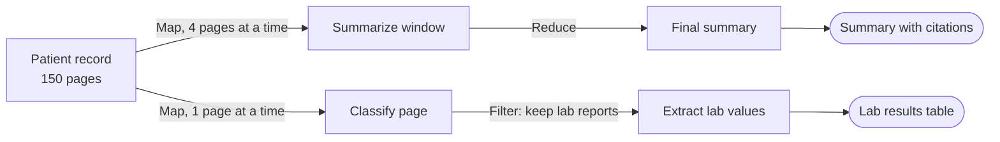

[Documentation](../README.md) › Start here › Overview

# Overview

What Document Engine is, what problem it solves, and how its parts fit together. Read this first if the
application is new to you; it takes five minutes and needs no technical background.

**On this page**

- [The problem](#the-problem)
- [What Document Engine does](#what-document-engine-does)
- [An example](#an-example)
- [Who uses it, and how](#who-uses-it-and-how)
- [What it runs on](#what-it-runs-on)
- [Where it stands today](#where-it-stands-today)

## The problem

A language model reads well, but three things get in the way of using one on real paperwork.

1. **Length.** A patient record or a contract file can run to hundreds of pages. Asking one question of the
   whole file at once gives shallow answers and loses track of where each fact came from.
2. **Repetition.** The useful work is the same few steps applied again and again: read a few pages and take
   notes, pick out the pages of one kind, combine the notes into an answer. Every team ends up writing the same
   plumbing around those steps.
3. **A shared quota.** The model endpoint allows a fixed number of tokens per minute, shared by everyone. One
   long file means hundreds of calls. Send them all at once and the endpoint rejects them; send several files
   and the jobs fight each other, and a person waiting for a two-page answer sits behind someone else's
   five-hundred-page batch.

## What Document Engine does

It answers each of the three.

- **A flow breaks the reading into steps.** A [flow](concepts.md#flow) is drawn on a canvas: files come in,
  [steps](concepts.md#step) read them a few pages at a time, later steps combine or filter what earlier steps
  found, and outputs collect the answers. Every finding keeps the page numbers it came from.
- **Flows are built, not programmed.** A person arranges blocks, writes each step's prompt in plain language,
  tests on a real file and sees an estimate of calls and cost before running anything. A finished flow is
  [published](../guide/publishing.md) and can then be run by other programs through an
  [endpoint](../api/README.md).
- **One scheduler shares the quota.** Every model call from every job goes through one
  [queue](../how-it-works/queue-and-priority.md) and one [ledger](../how-it-works/quota-ledger.md) of what the
  endpoint can take right now. Calls are sent only when there is room, so they are not rejected. Interactive
  jobs go ahead of bulk work.

## An example

The sample flow **Medical record summary** reads a 150-page record.

- One step reads the record four pages at a time and takes notes. That is about fifty calls.
- A second step receives all the notes at once and writes one summary, with a page reference after each
  statement.
- In parallel, another step labels every page by type. A filter keeps only the lab reports, and a last step
  pulls the values from those pages into a table.

The whole job is roughly two hundred model calls. The person who starts it sees each step fill in live, and at
the end reads a summary in which every statement opens the page it came from.

## Who uses it, and how

| Person | What they do | Where |
|---|---|---|
| **Flow author** | Builds a flow, tests it on files, publishes it | The [flow builder](../guide/builder.md) |
| **Caller** | A program that sends files to a published flow and collects results | The [API](../api/README.md) |
| **Operator** | Installs the application, sets the model limits, watches the load | [Setup and operations](../operations/README.md) |

## What it runs on

The application is one program with one start command. It needs two things beside itself:

- a **Postgres database**, which holds everything: flows, files, jobs, the queue, the ledger and the record of
  every call;
- a **model endpoint**, the Databricks AI Gateway, which serves the Claude models the steps call.

Because everything is in the database, several copies of the program can run at once and still share one
quota. [Architecture](../how-it-works/README.md) explains this in a page.

## Where it stands today

The scheduling approach was measured on the real gateway in an earlier proof of concept. The application
described here has so far run only against a stand-in for the gateway.

> **Not yet confirmed:** everything in this documentation that concerns the real gateway, Lakebase or
> Databricks Apps. [Limits and what is not confirmed](../operations/limits.md) lists each point and what is
> not yet built.

## See also

- [Concepts](concepts.md): the words used throughout, each in a sentence or two
- [Quick start](quick-start.md): run a sample flow and read its results
- [Build a flow](../guide/build-a-flow.md): make your own from an empty canvas
- [Under heavy load](../how-it-works/heavy-load.md): what the scheduler does when many jobs arrive together
